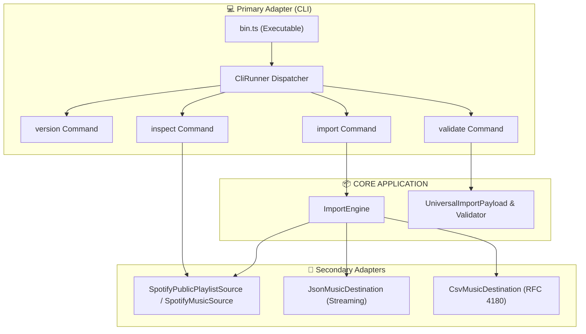

# Architecture: Phase 7 — CLI Transport Layer & Primary Adapter

## 1. Overview & Architectural Role

Phase 7 implements the **Command Line Interface (CLI)** primary (driving) adapter for the **Universal Music Import Engine**.

In Hexagonal Architecture (Ports & Adapters):
- The CLI lives strictly on the **outer perimeter** as a primary driving adapter.
- The core domain and application layer (`ImportEngine`, models, ports) remain 100% agnostic to CLI arguments, flags, terminals, and exit codes.
- Commands communicate exclusively through the universal ports (`MusicSource`, `MusicDestination`, `TrackNormalizer`, `CheckpointStore`).

---

## 2. CLI Command Suite

| Command | Usage | Description |
| :--- | :--- | :--- |
| **`version`** | `music-import version` | Displays CLI version and canonical domain Schema Version (`v1`). |
| **`import`** | `music-import import <playlist> [options]` | Imports tracks from Spotify URL/ID to JSON or CSV with bounded streaming memory. |
| **`validate`** | `music-import validate <file> [options]` | Validates exported JSON or CSV files against Schema v1 and RFC 4180 rules. |
| **`inspect`** | `music-import inspect <target> [options]` | Inspects remote Spotify playlist metadata or local export files without full ingestion. |

---

## 3. Exit Code Standard

The CLI enforces deterministic, POSIX-standard process exit codes:

| Exit Code | Name | Meaning |
| :---: | :--- | :--- |
| **0** | `SUCCESS` | Command completed successfully with no errors. |
| **1** | `ERROR` | Runtime error, network failure, or schema validation violation. |
| **2** | `INVALID_ARGUMENTS` | Command syntax error, missing required arguments, or unknown flags. |
| **130** | `CANCELLED` | Aborted via cancellation signal or SIGINT (128 + 2). |

---

## 4. Key Guarantees

1. **Zero Secret Leakage**:
   - Client secrets and credentials provided via flags or environment variables are never printed to `stdout` or `stderr`.
   - Error messages strip access tokens and authorization headers.
2. **Stream-Only Memory Efficiency**:
   - The CLI leverages streaming file sinks (`JsonMusicDestination`, `CsvMusicDestination`) to write batch chunks incrementally, maintaining constant low memory even for 10,000-track playlists.
3. **Pluggable & Fully Testable**:
   - The `CliRunner` and commands support dependency injection via `CliIo` (`stdout`, `stderr`, `exit`, `signal`) and command dependencies (`createSource`, `createDestination`, `writeFile`, `readFile`).
   - 100% of CLI behavior is validated via in-memory mock handlers without network or disk dependencies.
